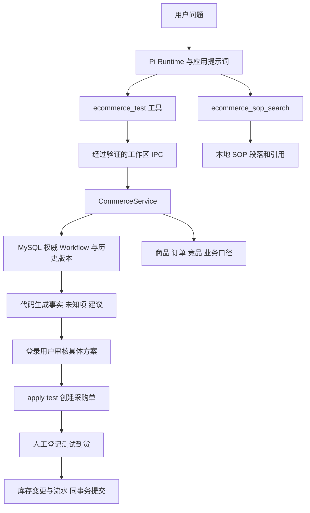

# 电商经营决策 Agent：本地测试闭环

本次依据《对话1.md》《对话2.md》和当前源码改造。目标是把库存调查、补充证据、人工审批、采购、到货入库连成可验证的流程。没有接真实商家、生产库存或供应商，不声称已经上线或带来经营收益。原有简历中的工具数、Token 数和业务指标没有因这次改造自动成立，需要独立重测。

## 现在可以实际运行什么

1. 按 SKU 检查库存；不指定 SKU 时，按类别和游标分页查询低库存商品。
2. 创建一份持久化调查任务，逐阶段推进 Monitor → Detect → Investigate → Decide。模型只传任务 ID、期望版本和必要参数，服务端读取权威状态。
3. 从商品、订单、竞品和业务口径生成事实、条件推断及动态未知项。已知的零值不会被当作缺失。
4. 人工补充带来源、时间的测试业务口径后，刷新同一任务的证据，再推进分析和决策。刷新使旧审批失效，历史任务版本仍可查询。
5. 提交具体采购方案，由已登录且有工作区访问权的人审批。Agent 的新工具没有审批、改业务口径或登记到货能力。
6. dry_run 只预览；apply(test) 在 MySQL 中真实创建采购单、增加在途量。另一次人工测试到货操作才增加库存，并写入库存流水。
7. 用数据库事务、行锁、版本检查、持久化幂等键和唯一约束处理重试及并发。生产环境执行直接拒绝。
8. 查询本地 SOP，返回文档段落、行号和版本哈希。该能力是轻量词法 RAG，不是向量检索。

## 启动和演示

需要 Node.js 和本机 MySQL 8 安装文件。驱动 mysql2 已加入项目依赖，正常安装完成后，数据库和演示不需要外网；真实模型推理仍需可用的模型服务。

在项目根目录的 PowerShell 执行：

```powershell
cd miniclaw
. .\scripts\start-ecommerce-test.ps1
npm run dev:all
```

脚本启动**独立的** MySQL 进程，监听 `127.0.0.1:13317`，使用 `data/ecommerce-local/mysql` 数据目录，不修改现有 MySQL80 服务。首次运行生成随机凭据，保存在已被 Git 忽略的 `data/ecommerce-local/connection.json`，不打印密码。点号加载脚本会将测试连接放入当前 PowerShell 环境，因此要在同一个窗口启动后端。

如果 MySQL 安装位置不同，先设置 `MINICLAW_MYSQL_BASEDIR`。端口被占用、存在未完成初始化的数据目录或身份不符时脚本停止，不删除目录或覆盖已有实例。

登录应用后，在导航栏打开“电商测试”（`/ecommerce`）：

1. 选择自己的 Web 工作区，点击“导入缺少的演示商品”。该操作只插入缺少的数据，不重置已有库存。
2. 输入 SKU-002，开始调查，点击三次“推进下一阶段”，分别进入 Detect、Investigate、Decide。
3. 查看未知项。填写测试业务口径，或点击“填入演示口径（非真实业务）”后确认保存。这些是明确设定的测试参数，不是程序自动查到的生产事实。
4. 点击“刷新证据并重查”，再推进两次。保存口径本身不会自动修改模型会话里的旧结论，必须重新查证。
5. 填写采购数量和供应商并提交方案。示例选 70 件，是为演示库存从 80 到 150，**不是模型算出的最优采购量**。
6. 在审批卡片核对 SKU、数量、供应商、总价、环境，填写理由后批准。无需再输入一遍精确确认短语。
7. 点击“创建测试采购单”。此时库存仍是 80，在途量增加 70。
8. 点击“确认整单测试到货并入库”。此时库存变成 150，在途量减少 70。重新调查查看库存变化。

也可以单独执行确定性的 CLI 演示：

```powershell
npm run ecommerce:demo
npm run ecommerce:test
```

CLI 演示明确以 `demo-human` 执行测试审批，不是让大模型自批；它会生成独立 demo 工作区并保留演示记录。测试使用独立 `test:<UUID>` 工作区并在完成后清理自己的行。没有配置数据库且没有本地连接文件时，MySQL 集成测试明确跳过；不可把跳过写成通过。

停止这次独立实例：

```powershell
npm run ecommerce:db:stop
```

下次重新点号加载启动脚本可恢复原数据。仅修改文件不会自动重启已在运行的后端或旧 Agent 容器；重新构建/启动 Runner 后，新工具才进入会话。

## 调用与数据流



Pi 执行工具循环；应用规定可用工具、身份来源、提示词和业务边界；领域服务执行计算和数据库事务。MCP 兼容工具定义不是数据库，也不是库存领域服务本身。此处通过现有进程内工具适配及 IPC 接宿主服务，未新增一个远程 MCP Server。

当前只使用 `commerce_command` IPC 和 `ec_*` MySQL 表。2026-10-23 已删除旧 JSON Adapter、JSON 样本文件、旧查询/Workflow/审批工具和 IPC 分支、旧 simulation/external 执行适配器及其测试。演示数据改为仅供 MySQL 初始化的 TypeScript fixture，正常查询不读取 fixture。旧 SQLite 审批表的历史迁移保留，避免改写已有数据库版本或删除用户数据；它没有可用的旧执行入口。只读 dry_run 仍保留，它是当前 MySQL 方案预览，不是已删除的 simulation。

## 状态、审批、幂等分别解决什么问题

- **Workflow revision**：同一调查任务每次推进或刷新加一；过期调用不能覆盖新状态。
- **Approval revision**：A、B 同时看见审批版本 1，只有第一个提交可以成功；另一个必须刷新，不能把审批状态覆盖回自己的旧判断。
- **Product version**：审批绑定当时商品和业务口径版本。库存、成本或口径变化后，旧方案不得直接执行。
- **幂等键**：标记同一次执行请求；网络超时后用同键重试，取回第一次结果，不再建单。同键参数不同则拒绝；换键重用已执行审批也拒绝。
- **事务与唯一约束**：采购单、在途量、执行回执和审批执行状态一起提交；收货、库存、流水和收货回执一起提交。失败全部回滚。同审批只一张采购单，同采购单只一次整单入库。

审批方案绑定 `environment、sku、quantity、supplier_id、unit_cost_cents、total_cost_cents、workflow_revision、product_version`；金额使用整数分。审批三十分钟过期，执行检查商品与业务口径是否在二十四小时内采集。时效值是本地测试策略，并非已和商家确认的生产 SLA。

业务未知项不能仅用“超过三项”来判断安全性：一个库存口径缺失也可能阻止执行。因此现在有未知项就给补充调查提示，同时在提交采购前单独校验关键业务输入。订单下单时间缺失可以继续被显示；已有明确近七天销量时，本测试链路不会用 pending 数量猜库存，也不会把缺少下单时间伪装成已补全。

## 数据库与索引的实际设计

业务数据按工作区隔离，SQL 参数化，所有权从登录会话或验证过的 IPC 来源取得，不能由模型传 `created_by` 或 `workspace_jid` 冒充。

主要表：`ec_products`、`ec_orders`、`ec_competitors`、`ec_workflows`、`ec_workflow_versions`、`ec_approvals`、`ec_executions`、`ec_purchase_orders`、`ec_receipts`、`ec_inventory_ledger`。Workflow 及各版本保存结构化 JSON；Evidence Chain 是状态里的结构化数组，**没有存进向量库**。历史版本保存刷新前的完整证据，不依赖模型记住旧数据。

商品主键 `(workspace, sku)` 支持按 SKU 查询；低库存使用生成列 `is_low_stock = (stock < safety_stock)` 及 `(workspace, is_low_stock, sku)` 索引，按 SKU 游标翻页；另有 `(workspace, category, sku)`。没有机械地分别给 stock 和 safety_stock 加索引，因为一般 B-tree 不能直接把两列不等式变成高效索引范围查询。

这里业务字段仍按模拟数据契约读取和校验。接真实系统应新增领域 API Adapter，明确库存口径、分页、采集时间及错误语义。不能简单把模型连上生产数据库，再允许任意 SQL。

## 记忆、上下文、知识召回怎么选

| 能力     | 本次状态与选择                                                        | 为什么                                                                               |
| -------- | --------------------------------------------------------------------- | ------------------------------------------------------------------------------------ |
| 短期会话 | 复用 Pi SDK Session、JSONL 保存恢复和原生 compaction                  | SDK 管消息历史和压缩；应用仍管提示词、身份、预算和工具返回                           |
| 长期记忆 | 保留 Workspace Memory 的 SQLite 结构化表、来源、版本、有效期          | 存用户偏好、历史决策，能按工作区撤回和审计                                           |
| 记忆召回 | 保留现有关键词检索；不足时补重要且有效的记忆                          | 保留总字符预算，超长记录不阻塞后续小记录；已删除召回诊断字段、日志和界面事件         |
| SOP RAG  | 新增本地分段 BM25，英文词与中文二元字组，带来源行和内容哈希，最多四段 | 回答操作规则并引用；不承担实时库存查询                                               |
| Milvus   | 未接入                                                                | 当前文档只有小型 SOP；尚无大量语义检索或跨语言召回质量证据支撑额外服务               |
| Redis    | 未接入                                                                | 单机事务和持久化状态已经解决当前正确性问题；没有分布式缓存、锁或跨节点限流的实际需求 |
| LLM Wiki | 未接入                                                                | 自动生成知识有来源漂移与更新责任问题，先维护可审计 SOP；Wiki 不是 RAG 的必需依赖     |
| 外部 MCP | 未新增真实服务接入                                                    | 接供应商/ERP 前需要真实协议、凭证、权限和沙箱；不能把本地函数包装叫作完整生产接入    |

SOP 的 RAG 流程是“问题 → 召回相关段落 → 工具结果进入模型上下文 → 回答引用来源”，并不要求向量库。这里是词法检索，不能宣称已验证复杂同义词、长文档或语义召回。Workspace Memory 的整句 FTS 查询对长自然语言提问也有局限，重要记忆兜底不等于相关性精排。

应用上下文改进还包括：电商工具可用时固定注入简短规则，不再用正则判断本轮是不是电商任务，也不新增 LLM 分类调用，因此“继续”这类跟进也保留规则。模型根据问题和工具说明选择调用，后端独立校验权限。工具不再要求模型回传全部 Workflow；模型只收到当前结构化摘要，完整证据从授权接口按需查看。订单证据超过 100 条或竞品超过 50 条时明确报预算错误，避免静默截断后给出完整分析的假象；后续接生产应实现时间窗口和服务端聚合。SOP 预算是段落和引用的字符预算，不冒充真实模型 Token 用量。SOP 保留段落来源引用，不返回额外召回诊断统计。

长期记忆写入规则补充了“先浓缩为一个持久事实、按主题拆条、保留来源引用”。这是 Agent 写入指导，不是新实现的服务端语义压缩器。现存超长记忆超出本轮预算时仍会跳过，本条原文不删除；多个短条目也共用总预算。Pi 的 compaction 压缩会话历史，不会自动压缩长期记忆库。数据库职责、示例和术语说明见 [当前架构说明](ECOMMERCE-CURRENT-ARCHITECTURE.md)。

## 生产化还需要什么

下列是下一阶段设计，**本轮没有实现**：

1. **真实业务 Adapter**：ERP/OMS/WMS、供应商的正式契约、成本版本、库存口径、真实到货事件、取消/部分到货/退货及对账。应由库存服务执行业务规则，不由 Agent 直接绕过业务库写库存。
2. **外部调用一致性**：单库事务不能保证数据库和外部供应商原子提交。接真实接口后需供应商幂等协议、Outbox、重试退避、查询确认、对账与补偿；本轮的本地事务不冒充跨系统 exactly-once。
3. **细粒度权限**：当前复用工作区所有权，尚未拆采购员、审批员、仓库员角色和金额分级；也没有双人审批或企业权限集成。
4. **运营可观测性**：生产审计留存、结构化 trace/metric、告警、备份恢复、迁移版本管理、数据保留策略、容量和压测。存在记录不等于已部署监控运维体系。
5. **模型评估**：用真实问题、工具轨迹、幻觉/越权/提示注入样本和失败恢复测试评价 LLM；这次确定性代码测试不能代表真实模型成功率。
6. **知识扩容**：先建立召回标注集，再比较 BM25、向量和混合检索的 Recall@K/引用正确率，达到需要时引入 Milvus 与 embedding 模型。多实例确有需要时再加 Redis，并设计失效和一致性。

## 源码入口

- [领域服务与事务](../src/ecommerce/commerce-service.ts)
- [测试库限制、建表与索引](../src/ecommerce/test-db.ts)
- [确定性四阶段分析](../src/ecommerce/workflow.ts)
- [模型命令白名单](../src/ecommerce/agent-dispatch.ts)
- [Pi 工具定义](../container/agent-runner/src/commerce-tools.ts)
- [人工 HTTP 接口](../src/routes/ecommerce.ts)
- [操作页面](../web/src/pages/EcommercePage.tsx)
- [SOP 检索](../src/ecommerce/sop-search.ts)
- [记忆选择和预算](../src/memory-service.ts)
- [MySQL 集成测试](../tests/ecommerce-mysql.integration.test.ts)
- [实际验证记录与演示证据](ECOMMERCE-VALIDATION.md)
